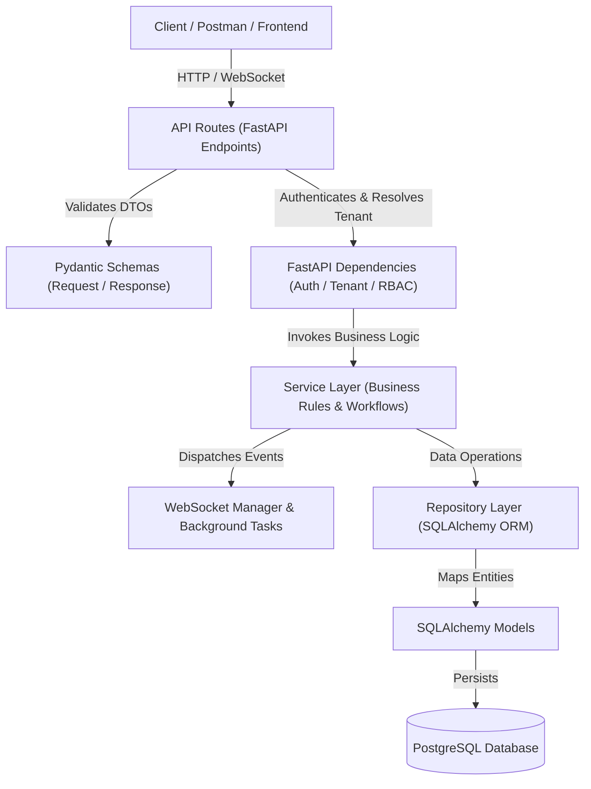
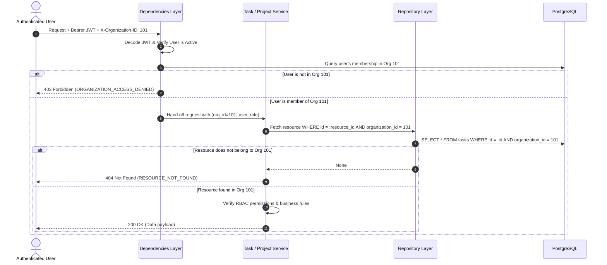
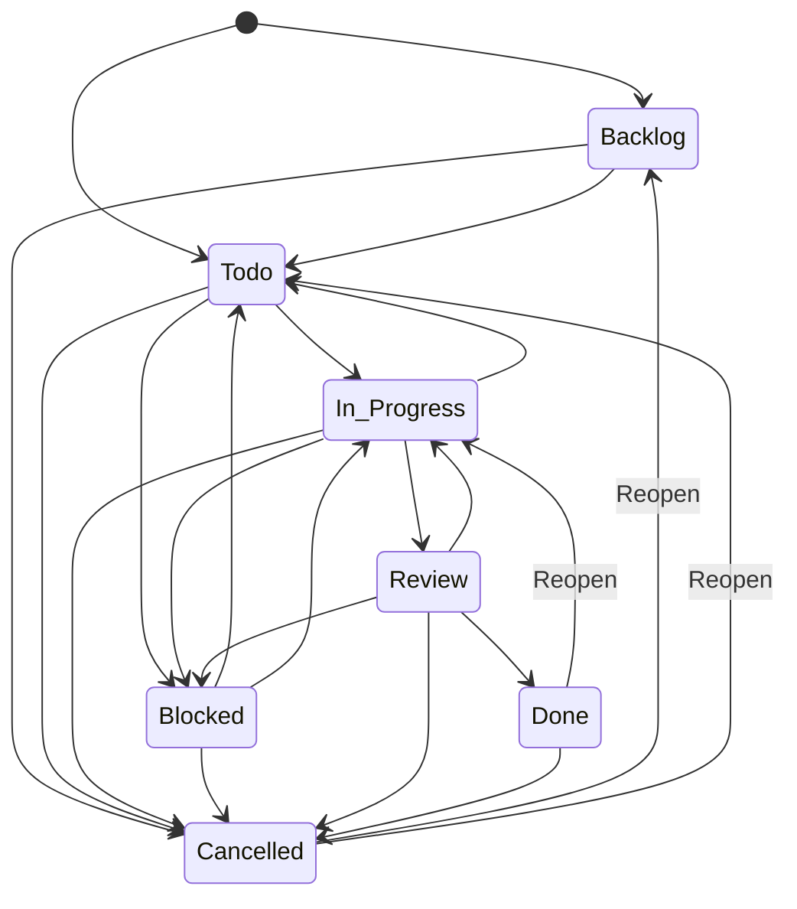

# System Architecture Documentation

This document describes the architectural design, patterns, and principles implemented in the **Multi-Tenant Project & Workflow Management Platform**.

---

## 1. Clean Architecture (Layered Design)

The system adheres to Clean Architecture principles to enforce separation of concerns between HTTP transport, business rules, data access, and storage.

### Layer Responsibilities

1. **Routes (`app/api/v1/endpoints/`)**:
   - Handles HTTP routing, path/query parsing, and response status codes.
   - Enforces zero business logic directly inside routes.
2. **Dependencies (`app/api/dependencies.py`)**:
   - Authenticates Bearer JWT tokens.
   - Resolves active organization context (`X-Organization-ID` or user membership).
   - Verifies role-based access before the service is invoked.
3. **Services (`app/services/`)**:
   - Enforces core business invariants (workflow transitions, circular dependency detection, assignment rules).
   - Generates audit logs and triggers real-time notifications.
4. **Repositories (`app/repositories/`)**:
   - Abstracts raw database queries and filtering logic.
   - Keeps queries modular, reusable, and testable.
5. **Models (`app/models/`)**:
   - SQLAlchemy ORM entity definitions with indexes and foreign keys.

---

## 2. Multi-Tenant Isolation Flow

---

## 3. Role-Based Access Control (RBAC) Matrix

| Action / Capability | Super Admin | Organization Admin | Project Manager | Team Member | Viewer |
|---|:---:|:---:|:---:|:---:|:---:|
| Create Organization | Yes | Yes | Yes | Yes | Yes |
| Manage Org Members & Roles | Yes | Yes | No | No | No |
| Create Project | Yes | Yes | Yes | No | No |
| Update / Archive Project | Yes | Yes | Yes | No | No |
| Delete Project | Yes | Yes (Owner) | Yes (Owner) | No | No |
| Add Members to Project | Yes | Yes | Yes | No | No |
| Create Task | Yes | Yes | Yes | Yes | No |
| Assign Task | Yes | Yes | Yes | No | No |
| Move Task Workflow Status | Yes | Yes | Yes | Yes (Assigned) | No |
| Add Task Dependencies | Yes | Yes | Yes | Yes | No |
| Add Comments | Yes | Yes | Yes | Yes | No |
| Edit / Delete Own Comments | Yes | Yes | Yes | Yes | No |
| Moderate Any Comments | Yes | Yes | No | No | No |
| Upload Files | Yes | Yes | Yes | Yes | No |
| View Dashboards & Tasks | Yes | Yes | Yes | Yes | Yes (Read-only) |
| View Audit Logs | Yes | Yes | Yes | No | No |

---

## 4. Task Workflow State Machine

### Dependency Gating Rule
Before transitioning into **`In_Progress`**, **`Review`**, or **`Done`**, the service queries all tasks that the current task depends on (`task_dependencies.depends_on_task_id`). If any prerequisite task is not in status **`DONE`**, the transition is rejected with code `UNRESOLVED_DEPENDENCY`.

---

## 5. Circular Dependency Detection (Directed Acyclic Graph)

When adding a dependency (`Task A depends on Task B`):
1. The backend builds the project's dependency adjacency list $G = (V, E)$ where an edge $(u, v)$ means $u$ depends on $v$.
2. To add edge $(A, B)$, the system checks if a directed path already exists from $B$ to $A$ using Depth-First Search (DFS) / Breadth-First Search (BFS).
3. If $B \rightsquigarrow A$ exists, adding $(A, B)$ would complete a directed cycle ($A \rightarrow B \rightsquigarrow A$).
4. The system immediately rejects the operation with error code `CIRCULAR_DEPENDENCY_DETECTED`.

---

## 6. Security & File Upload Verification

Client-supplied file extensions and MIME headers can be forged. To counter malicious uploads:
1. **File Extension Whitelist**: Only allowed extensions (`.pdf`, `.docx`, `.xlsx`, `.csv`, `.png`, `.jpg`, `.jpeg`, `.gif`, `.txt`, `.zip`).
2. **File Size Enforcement**: Strict maximum threshold (`10 MB`).
3. **Magic Bytes Content Inspection**:
   - PDF files must start with `%PDF-` (`0x25 0x50 0x44 0x46 0x2D`).
   - PNG files must start with `\x89PNG\r\n\x1a\n`.
   - JPEG files must start with `\xFF\xD8\xFF`.
   - ZIP/DOCX/XLSX files must start with `PK\x03\x04`.
   - Plain text / CSV files are inspected for null-byte binary payloads (`\x00`).
4. **Tenant-Isolated Storage**: Files are stored in disk folders strictly scoped by organization ID: `uploads/{organization_id}/{uuid}_{filename}`.
