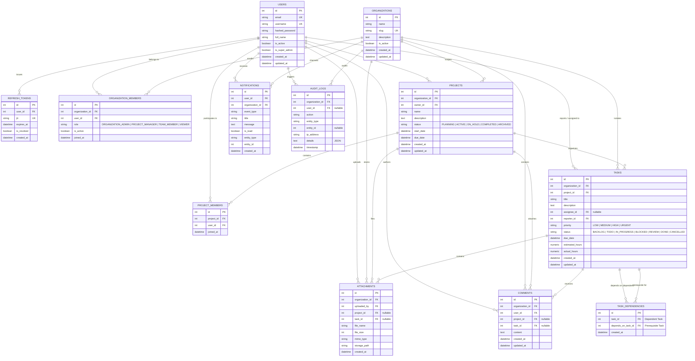

# Entity-Relationship (ER) Diagram

This document illustrates the complete PostgreSQL database schema design for the **Multi-Tenant Project & Workflow Management Platform**.

## Schema Overview

The architecture enforces multi-tenancy at the relational level:
- **`organizations`** represents each isolated tenant.
- **`organization_members`** establishes tenant memberships with role assignment (`ORGANIZATION_ADMIN`, `PROJECT_MANAGER`, `TEAM_MEMBER`, `VIEWER`).
- All primary business entities (**`projects`**, **`tasks`**, **`comments`**, **`attachments`**, **`notifications`**, **`audit_logs`**) carry foreign keys to `organizations(id)` with cascading deletes and composite unique indexes to guarantee total isolation.

---

## Mermaid ER Diagram

---

## Key Constraints & Invariants

1. **Multi-Tenant Data Isolation**:
   - `tasks.organization_id == projects.organization_id`
   - Every individual resource lookup queries with `organization_id == active_tenant_id`.
   - Modifying entity IDs across organizations returns `404 Not Found` or `403 Forbidden`.

2. **Composite Unique Constraints**:
   - `organization_members`: `UNIQUE(organization_id, user_id)` (A user can join an organization only once).
   - `project_members`: `UNIQUE(project_id, user_id)` (A user cannot be duplicated in the same project).
   - `task_dependencies`: `UNIQUE(task_id, depends_on_task_id)` (Prevents redundant dependency links).

3. **Cascading & Referential Integrity**:
   - `ondelete="CASCADE"` on organizations cleanly wipes child projects, tasks, comments, files, and audit records when an organization is purged.
   - `ondelete="SET NULL"` on `tasks.assignee_id` preserves tasks when a user is deactivated or removed.
   - `ondelete="CASCADE"` on `task_dependencies` ensures dependent links are cleanly removed when prerequisite tasks are deleted.
